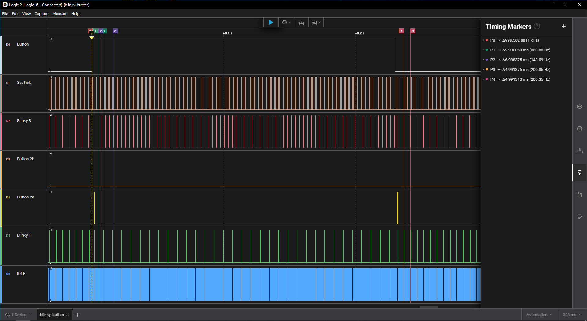
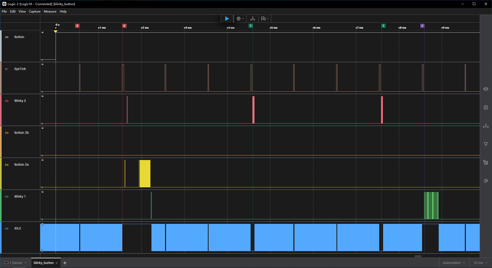
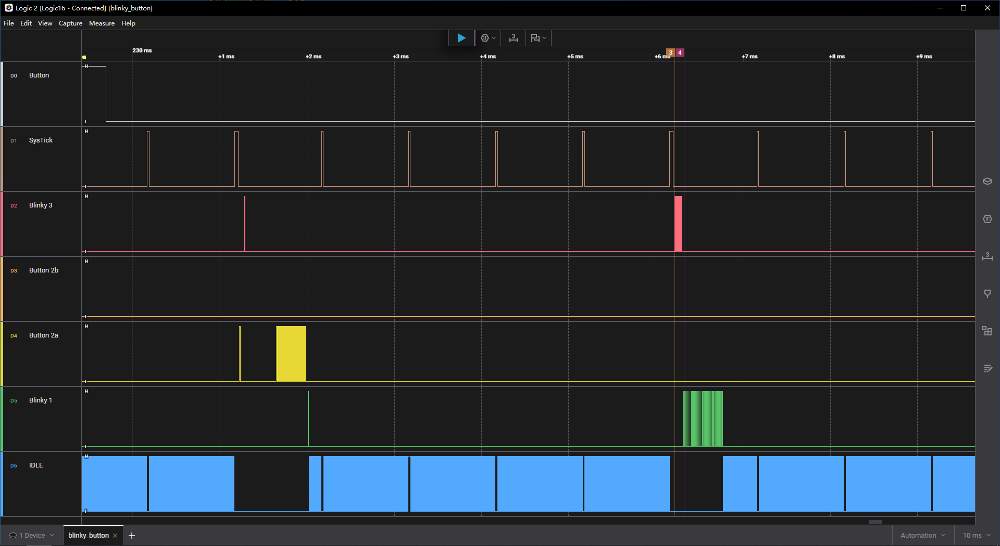
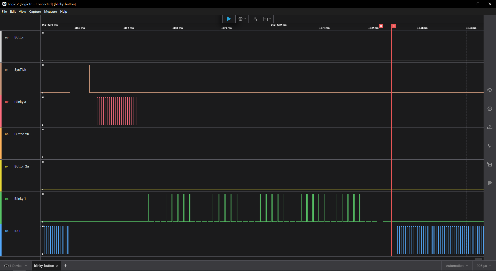
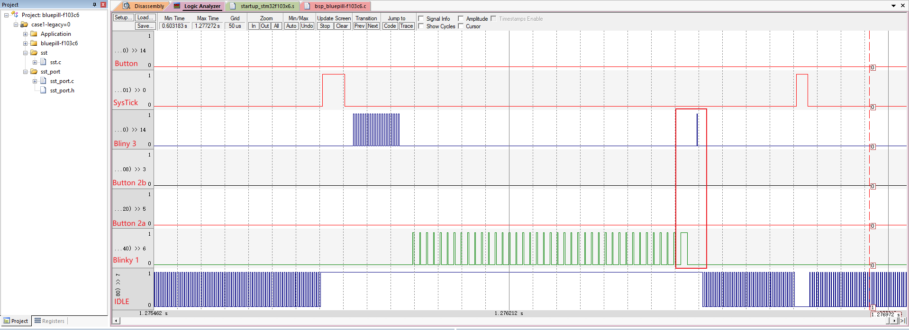
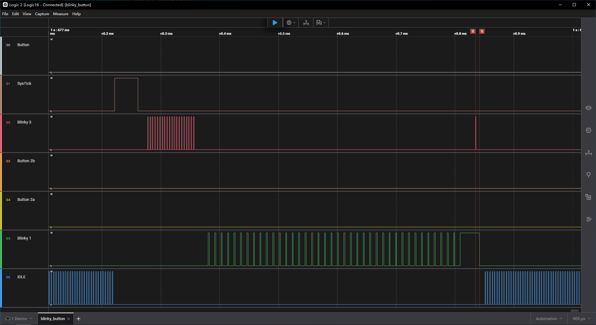
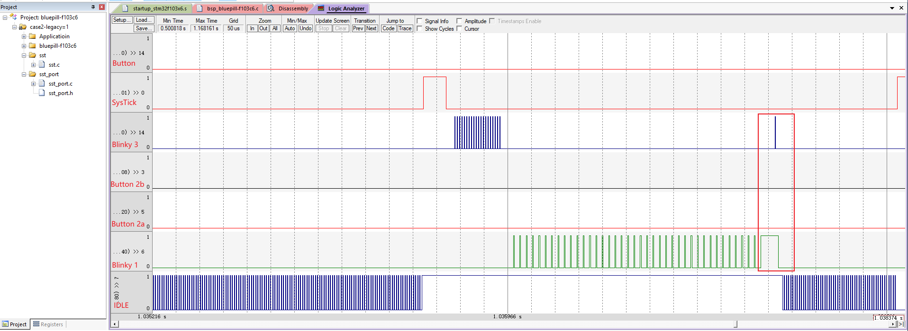

# Test Priority Ceiling

## Background

SST implements the priority ceiling by setting BASEPRI in SST_Task_lock().
But in the blinky_button example it is hard to observe whether it works as
expected.

## Plan

- Add the TEST_PEND_SIG signal:
  - Blinky1 posts TEST_PEND_SIG to Blinky3 on the last IO toggle of TIMEOUT_SIG
  - Blinky3 toggles IO when it receives TEST_PEND_SIG signal
- Add two macros (switches):
  - SST_PORT_USE_LEGACY_BASEPRI: whether to use legacy BASEPRI
  - SST_TEST_PRIORITY_CEILING: whether to post TEST_PEND_SIG

If the ceiling works, Blinky3 cannot preempt Blinky1.
So BSP_d2on()/BSP_d2off() will run after BSP_d5off().

### Diff

blinky_button.h

```patch
enum Signals {
     BLINKY_WORK_SIG,
     FORWARD_PRESSED_SIG,
     FORWARD_RELEASED_SIG,
+    TEST_PEND_SIG, /* injected by Blinky1 to verify scheduler locking */
     /* ... */
     MAX_SIG  /* the last signal */
 };
```

blinky1.c

```patch
static void Blinky1_dispatch(Blinky1 * const me, SST_Evt const * const e) {
                 /* just to exercise SST task scheduler lock... */
                 SST_LockKey key = SST_Task_lock(3U);
                 BSP_d5on();
+#if defined(SST_TEST_PRIORITY_CEILING) && (SST_TEST_PRIORITY_CEILING== 1)
+                static SST_Evt const TestPendEvt = { .sig = TEST_PEND_SIG };
+                if (i == 1) {
+                    SST_Task_post(AO_Blinky3, &TestPendEvt);
+                }
+#endif
                 BSP_d5off();
                 SST_Task_unlock(key);
             }

```

blinky3.c

```patch
static void Blinky3_dispatch(Blinky3 * const me, SST_Evt const * const e) {
             }
             break;
         }
+        case TEST_PEND_SIG: {
+            BSP_d2on();
+            BSP_d2off();
+            break;
+        }
         case BLINKY_WORK_SIG: {
             BSP_d2on();
             SST_TimeEvt_arm(&me->te,
```

sst_port.c

```patch
SST_LockKey SST_Task_lock(SST_TaskPrio ceiling) {
                          << nvic_prio_shift;
     SST_LockKey basepri_; /* initialized in the following asm() instruction */
     __asm volatile ("mrs %0,BASEPRI" : "=r" (basepri_) :: );
+#if defined(SST_PORT_USE_LEGACY_BASEPRI) && (SST_PORT_USE_LEGACY_BASEPRI == 1)
+    if (basepri_ > nvic_prio) { /* current priority lower than the ceiling? */
+#else
     /* masking disabled, or current priority lower than the ceiling? */
     if ((basepri_ == 0U) || (basepri_ > nvic_prio)) {
+#endif
         __asm volatile ("cpsid i\n msr BASEPRI,%0\n cpsie i"
                         :: "r" (nvic_prio) : );
     }
```

## Case0: SST_PORT_USE_LEGACY_BASEPRI=0, SST_TEST_PRIORITY_CEILING=0





## Case1: SST_PORT_USE_LEGACY_BASEPRI=0, SST_TEST_PRIORITY_CEILING=1




Result: BSP_d2on()/BSP_d2off() run **after** BSP_d5off() => Pass

## Case2: SST_PORT_USE_LEGACY_BASEPRI=1, SST_TEST_PRIORITY_CEILING=1




Result: BSP_d2on()/BSP_d2off() run **before** BSP_d5off() => Fail
